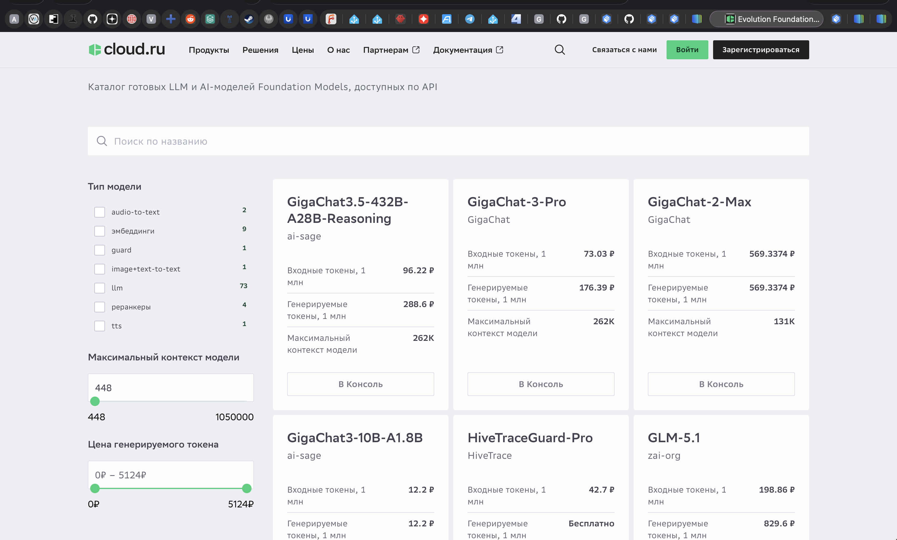
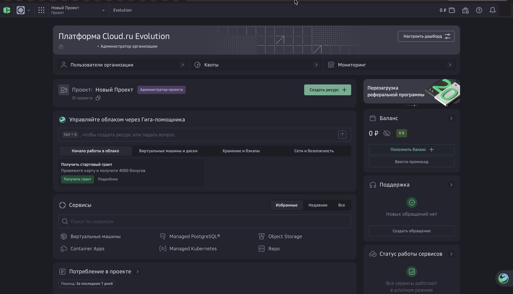
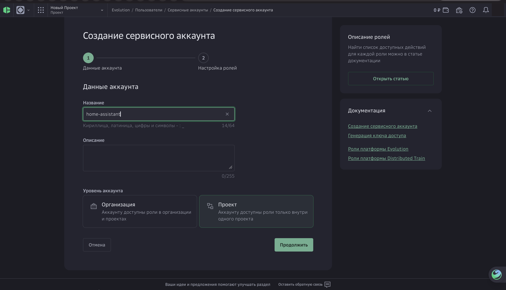
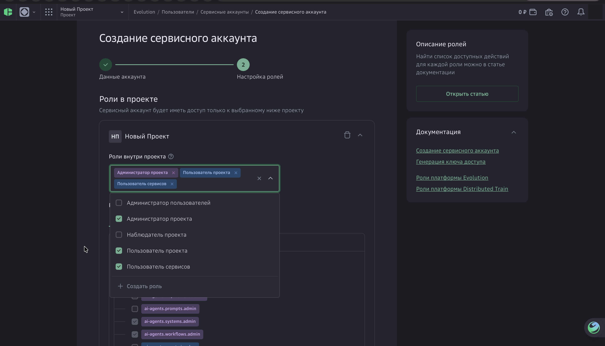
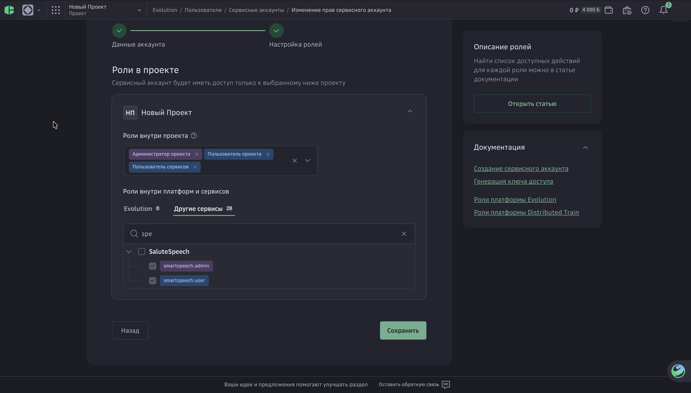
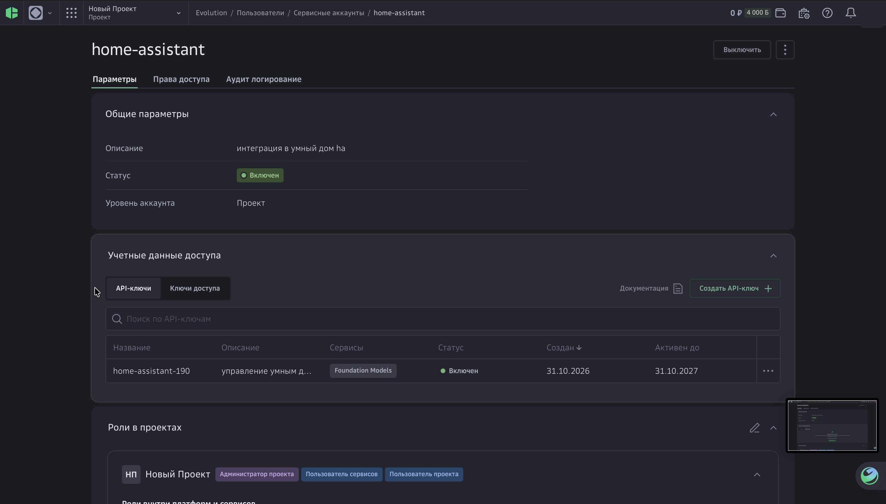
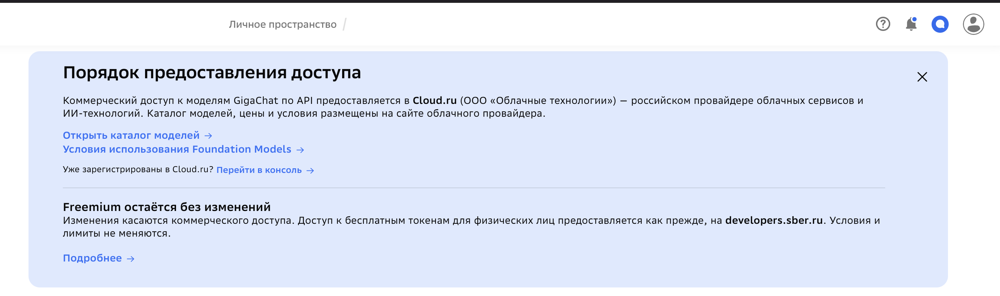

# 🔑 Как получить API-ключи для Sber GigaChat AI (Cloud.ru Evolution Foundation Models и Sber Studio)

С сентября 2026 года Сбер перевёл подключение новых клиентов к семейству **GigaChat 3 / 3.5**, распознаванию речи **GigaASR (`audio-to-text`)**, синтезу речи **SaluteSpeech (`tts`)** и **Vision-моделям** в облачную платформу **[Cloud.ru Evolution Foundation Models](https://cloud.ru/products/evolution-ai-factory/catalog-foundation-models)**. В то же время доступ к проекту **`GigaChat API`** для физических лиц (включая `GigaChat-2-Pro`, `GigaChat-3-Ultra`, мультимодальный вход для аудио/камер и генерацию картинок **Kandinsky 3.1**) предоставляется в личном кабинете **[Sber Studio (`developers.sber.ru/studio`)](https://developers.sber.ru/studio)**.

Интеграция **Sber GigaChat AI** для Home Assistant поддерживает **оба ключа одновременно (гибридный режим)**:

1. 🌟 **Поле 1 — API-ключ Cloud.ru Evolution Foundation Models (`Key Secret`)**
   - Обеспечивает работу **синтеза речи (`SaluteSpeech TTS`)** через WebSocket `/v1/realtime` (`GigaChat/SaluteSpeech` — 9 голосов 24 кГц: `Bab-Freespeech`, `Bab-Energetic`, `Bab-Debate`, `Mer-Operator`, `Kaz-Lifelike`, `Tsb-Freespeech`, `Tsb-Hesitating`, `Gli-Freespeech`, `Gli-Operator`).
   - Открывает доступ к моделям каталога Cloud.ru Foundation Models:
     - **GigaChat 3 Pro** (`GigaChat/GigaChat-3-Pro` — 73 / 176 ₽ за 1 млн токенов),
     - **GigaChat 3.5 Reasoning** (`ai-sage/GigaChat3.5-432B-A28B-Reasoning` — 96 / 288 ₽ за 1 млн токенов),
     - **GigaChat 3 10B** (`ai-sage/GigaChat3-10B-A1.8B` — 12.2 ₽ за 1 млн токенов),
     - **Распознавание речи (STT)**: `GigaChat/GigaASR` (0.01 ₽/сек) и `openai/whisper-large-v3` (0.0061 ₽/сек),
     - **Vision (анализ камер)**: `Qwen/Qwen3.6-35B-A3B`, `Qwen/Qwen3.5-397B-A17B`, `moonshotai/Kimi-K2.6`.

2. 🧩 **Поле 2 (Опциональный ключ #1 — рекомендуется указывать в паре с Полем 1) — Ключ авторизации GigaChat в Sber Studio (`Authorization Key`)**
   - Открывает доступ к **Freemium-режиму для физлиц (365 000 000 бесплатных токенов на 12 месяцев)**: 250M на `GigaChat-2` (Lite), 50M на `GigaChat-3-Ultra`, 40M на `GigaChat-2-Pro` и 25M на `GigaChat-2-Max` (по [официальным тарифам для физлиц](https://developers.sber.ru/docs/ru/gigachat/tariffs/individual-tariffs)).
   - Обеспечивает работу сервисов Sber Studio и служит автоматическим резервом (фоллбэком), если на балансе Cloud.ru недостаточно средств (`402`):
     - 💬 **Диалоги и управление умным домом (`GigaChat Conversation`)** на моделях `GigaChat-2-Pro` (0.50 ₽ / 1K вне Freemium), `GigaChat-3-Ultra` (Freemium 50M), `GigaChat-2-Max` (0.65 ₽ / 1K), `GigaChat-2` (0.065 ₽ / 1K);
     - 🎙 **Распознавание речи (`GigaChat Audio STT`)** — автоматический фоллбэк через мультимодальную загрузку аудио (`POST /api/v1/files` + `GigaChat-2-Pro`);
     - 👁 **Vision-анализ камер (`GigaChat AI Task`)** через `/api/v1/files`;
     - 🎨 **Генерацию изображений Kandinsky 3.1 (`GigaChat AI Task image`)** (`text2image` доступен только в Sber Studio).

3. 🗄 **Поле 3 (Опциональный ключ #2 — только для архивных проектов) — Архивный ключ SaluteSpeech в Sber Studio**
   - **Оставьте это поле ПУСТЫМ**, если у вас нет старого (созданного до закрытия) проекта `SaluteSpeech` в `developers.sber.ru/studio`. При пустом Поле 3 синтез речи и распознавание голоса автоматически работают через связку Поля 1 (`Cloud.ru`) и Поля 2 (`Sber Studio`).

---

## 🌟 Вариант А. Получение единого API-ключа в Cloud.ru Evolution Foundation Models

1. На странице каталога [Cloud.ru Foundation Models](https://cloud.ru/products/evolution-ai-factory/catalog-foundation-models) нажмите кнопку **«В Консоль»** на карточке любой модели (например, **GigaChat-3-Pro**) или перейдите напрямую в [console.cloud.ru](https://console.cloud.ru/spa/ml-foundation-models/models).

  

2. Войдите по **Сбер ID** в консоль **Cloud.ru Evolution** (при желании активируйте стартовый грант **4000 бонусов** и нажмите **«Пользователи организации»**).

  

3. В разделе **Пользователи -> Сервисные аккаунты** нажмите **Создать аккаунт**, укажите название (например, `home-assistant`), выберите уровень **Проект** и нажмите **Продолжить**.

  

4. На шаге **«Настройка ролей»** выберите роли (`Администратор проекта`, `Пользователь проекта`, `Пользователь сервисов`), а также во вкладке **«Другие сервисы»** отметьте **`SaluteSpeech -> smartspeech.admin`** и нажмите **Создать / Сохранить**.

  

  

5. Откройте созданный сервисный аккаунт (`home-assistant`) -> в блоке **Учётные данные доступа** нажмите **Создать API-ключ**.
6. Выберите сервис **Foundation Models**, нажмите **Создать** и **скопируйте `Key Secret`** — вставьте его в первое поле **«API-ключ Cloud.ru Foundation Models»** в Home Assistant!

  

---

## 🧩 Вариант Б. Получение `Authorization Key` в Sber Studio (для моделей Sber Studio и Kandinsky 3.1)

> 💡 Доступ к моделям Sber Studio (включая **`GigaChat-2-Pro`**, **`GigaChat-3-Ultra`**, мультимодальный анализ аудио/камер и генерацию изображений **Kandinsky 3.1**) предоставляется в личном кабинете **developers.sber.ru**.

  

1. На главной странице личного кабинета [Sber Studio](https://developers.sber.ru/studio) нажмите на уже существующую карточку вашего проекта **`GigaChat API`** (в Sber Studio лимит — 1 проект `GigaChat API` на аккаунт, поэтому при нажатии «Создать проект» он отображается серым с подписью *«Закончился лимит»*).
2. В левом меню проекта откройте раздел **Настройки API**.
3. Нажмите кнопку **Получить ключ** (или **Получить новый ключ**) и скопируйте **`Authorization Key`** (строка Base64).
4. Вставьте его во второе поле **«Ключ авторизации GigaChat в Sber Studio»** при настройке интеграции в Home Assistant.

---

## ⚙️ Шаг 4. Ввод данных в Home Assistant (Как правильно заполнить все 3 поля ключей)

1. В Home Assistant перейдите в **Настройки -> Устройства и службы -> Добавить интеграцию** (или нажмите `⋮` -> **«Настроить»** у уже добавленной интеграции).
2. Найдите **Sber GigaChat AI**.
3. Заполните поля следующим образом:
   - **Поле 1 — «1. API-ключ Cloud.ru Foundation Models»**: вставьте сюда ваш `Key Secret` от сервисного аккаунта `home-assistant` в Cloud.ru.
     - Через этот ключ работают синтез речи **`SaluteSpeech TTS`** (`/v1/realtime` — 9 голосов: `Bab-Freespeech`, `Bab-Energetic`, `Bab-Debate`, `Mer-Operator`, `Kaz-Lifelike`, `Tsb-Freespeech`, `Tsb-Hesitating`, `Gli-Freespeech`, `Gli-Operator`) и модели каталога Cloud.ru Foundation Models.
   - **Поле 2 — «2. Ключ авторизации GigaChat в Sber Studio (рекомендуется)»**: вставьте ваш `Authorization Key` (Base64) из проекта `GigaChat API` в `developers.sber.ru/studio`.
     - **Рекомендуется заполнить в паре с Полем 1!** По этому ключу работают модели Sber Studio (`GigaChat-2-Pro`, `GigaChat-3-Ultra`, `GigaChat-2`), мультимодальное распознавание голоса **GigaChat Audio STT** (автоматический резерв для Cloud.ru STT), анализ камер **Vision** и генерация картинок **Kandinsky 3.1 (`text2image`)**.
   - **Поле 3 — «3. Архивный ключ SaluteSpeech в Sber Studio»**: **оставьте полностью пустым!**
     - Это поле предназначено исключительно для старых архивных ключей `SALUTE_SPEECH_PERS` из `developers.sber.ru`. Когда оно пустое, распознавание и синтез речи автоматически используют Поле 1 и Поле 2.
   - **Проверять SSL-сертификат НУЦ Минцифры**: оставьте **выключенным** (`False`).
4. Нажмите **Отправить** — все 5 служб (`GigaChat Conversation`, `GigaASR / SaluteSpeech STT`, `SaluteSpeech TTS`, `GigaChat AI Task`, `GigaChat AI Task image`) будут созданы автоматически!

---

## ❓ Частые вопросы и коды ошибок

| Ситуация / Код ошибки | Причина | Решение |
| :--- | :--- | :--- |
| В логе `Cloud.ru STT requires ruble balance (402); switching to Sber Studio GigaChat Audio STT` | На счёте в Cloud.ru не пополнен рублёвый баланс для тарифицируемых эндпоинтов | **Штатное поведение гибридного режима:** интеграция автоматически переключила распознавание речи на ключ Sber Studio из Поля 2. |
| `402: Not enough money` (в чате Assist) | Заполнено только Поле 1 (`Cloud.ru`) без рублёвого баланса на счёте, а Поле 2 (`Sber Studio`) оставлено пустым | Добавьте во **2-е поле** ключ `Authorization Key` из `developers.sber.ru/studio` (через меню интеграции `⋮` -> **Настроить**) или пополните счёт в Cloud.ru. |
| `400 Can't decode 'Authorization' header` | В **3-е поле** (`SaluteSpeech в Sber Studio`) по ошибке вставлен ключ от Cloud.ru | **Очистите 3-е поле** (`Архивный ключ SaluteSpeech в Sber Studio`), а ключ от Cloud.ru оставьте только в **1-м поле**. |
| `401 Unauthorized` | Скопирован `Client ID` или `Key ID` вместо `Authorization Key` (Base64) / `Key Secret` | В Sber Studio копируйте именно **`Authorization Key`**, а в Cloud.ru — **`Key Secret`** сервисного аккаунта. |
| `SSL Certificate Verify Failed` | В контейнере Home Assistant нет корневого сертификата НУЦ Минцифры РФ | Оставьте галочку **«Проверять SSL-сертификат НУЦ Минцифры»** выключенной. |

---

⬅️ **[Вернуться к основной документации (README.md)](README.md)**
