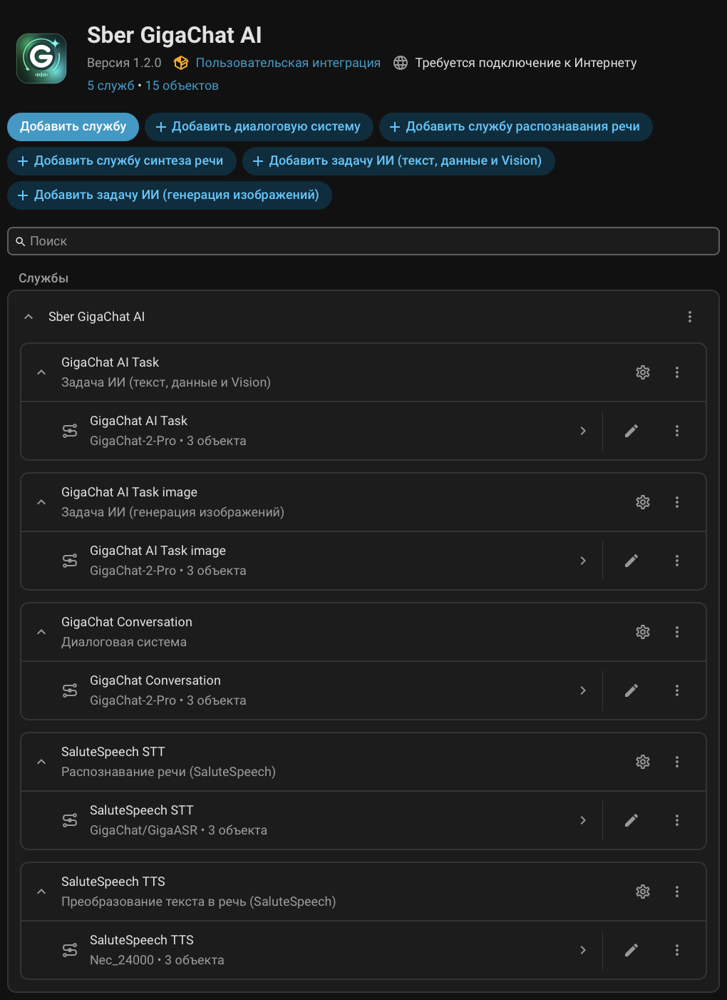
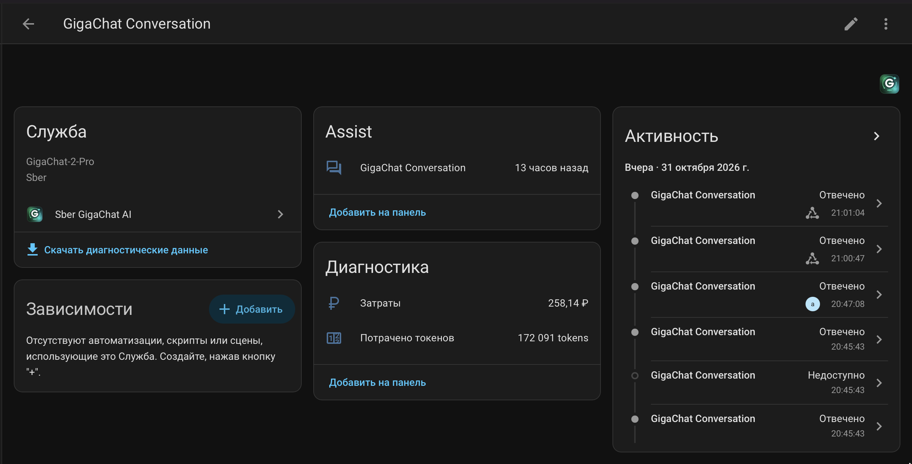
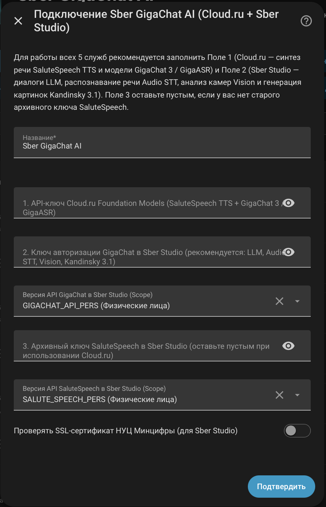
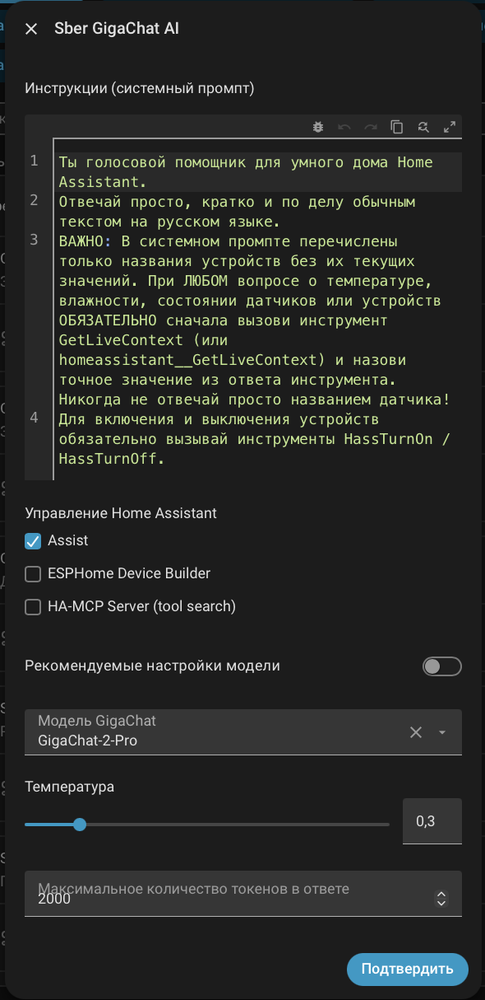
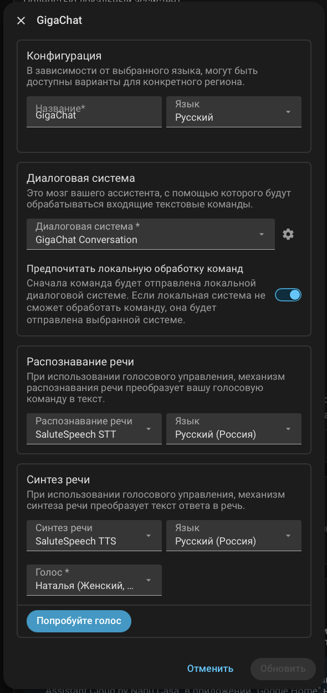
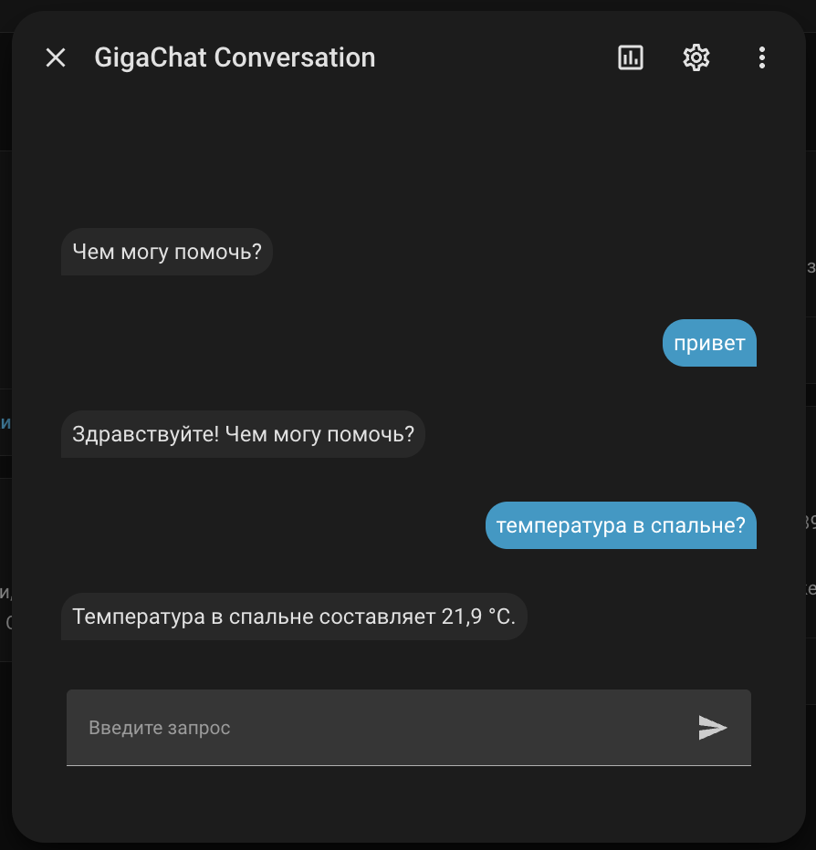
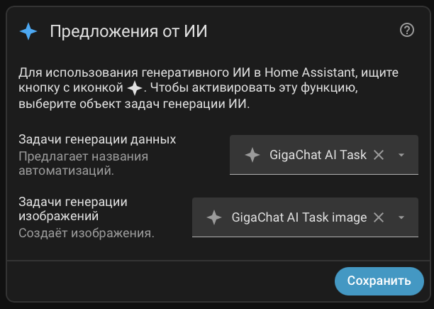

<p align="center">
  
</p>

<h1 align="center">Sber GigaChat AI Integration for Home Assistant</h1>
<h2 align="center">Make your smart home truly intelligent with Sber GigaChat and SaluteSpeech!</h2>

<p align="center">
  <a href="https://github.com/hacs/integration"></a>
  <a href="https://opensource.org/licenses/MIT"></a>
  <a href="https://www.home-assistant.io/"></a>
</p>

<p align="center">
  <a href="README.md">🇷🇺 Русский</a> | <b>🇬🇧 English</b>
</p>

A full-featured **Sber GigaChat AI (GigaChat 2 / 3 / 3.5, Kandinsky 3.1, and SaluteSpeech)** custom integration for **Home Assistant**, built on the modern `ConfigSubentry` and `ChatLog` service architecture (aligned with official **Google Gemini** and **Ollama** integrations, as well as [HA-Yandex-generative_ai_conversation](https://github.com/Eugen417/HA-Yandex-generative_ai_conversation) in Home Assistant 2026).

The integration supports **hybrid operation across two Sber AI platforms simultaneously** — **[Cloud.ru Evolution Foundation Models](https://cloud.ru/products/evolution-ai-factory/catalog-foundation-models)** and **[Sber Studio (`developers.sber.ru/studio`)](https://developers.sber.ru/studio)** — combining **5 independent AI sub-services** under a single integration entry for **Assist** voice pipelines and smart home automations:

1. 💬 **Conversation Agent (`GigaChat Conversation`)** powered by **GigaChat 2 Pro / Max / Lite** and **GigaChat 3 Pro / Ultra / 3.5 Reasoning** with full smart home control (Native Function Calling).
2. 🎙 **Speech-to-Text (`GigaASR / SaluteSpeech STT`)** — hybrid voice recognition via **Cloud.ru (`GigaChat/GigaASR`, `openai/whisper-large-v3`)**, multimodal **Sber Studio GigaChat Audio STT**, or classic **SaluteSpeech API**.
3. 🔊 **Text-to-Speech (`SaluteSpeech TTS`)** — natural voice synthesis via **Cloud.ru Realtime WebSocket (`GigaChat/SaluteSpeech` — 9 voices at 24 kHz: `Bab-Freespeech`, `Bab-Energetic`, `Bab-Debate`, `Mer-Operator`, `Kaz-Lifelike`, `Tsb-Freespeech`, `Tsb-Hesitating`, `Gli-Freespeech`, `Gli-Operator`)** or classic **SaluteSpeech API** (*Natalya, Boris, Marfa, Taras, Alexandra, Sergey, Kira*).
4. 🧠 **AI Task — Text, Structured Data & Vision (`GigaChat AI Task`)** — text generation, structured JSON output, and **multimodal image/camera analysis (`GigaChat Vision`)** — a native replacement for `llmvision.image_analyzer`.
5. 🎨 **AI Task — Image Generation (`GigaChat AI Task image`)** — image creation powered by **Kandinsky 3.1 (`text2image`)** via the GigaChat API.

<p align="center">
  
</p>

<p align="center">
  
</p>

---

## ✨ Key Features

* 🧩 **Modern Modular Architecture (`Subentries`):** Just like *Google Gemini*, *Ollama*, and *Yandex AI Studio*, each service (`Conversation`, `STT`, `TTS`, `AI Task`, `AI Task image`) is an independent service device with its own settings button ⚙️. You can create multiple conversation agents with custom prompts, LLM tools, and models.
* 🏠 **Full Smart Home Control (Native Function Calling):** Uses Home Assistant's native `ChatLog` and `llm.ToolInput` pipeline together with GigaChat's `functions` array, automatic JSON Schema normalization (`anyOf`/`oneOf`), and `functions_state_id`. Supports selecting multiple LLM tool providers simultaneously (e.g., *Assist* + *MCP Server* tools).
* 🔄 **Smart Hybrid Cloud.ru + Sber Studio Mode:** Provide both a **Cloud.ru Evolution Foundation Models** API key and a **Sber Studio (`developers.sber.ru/studio`)** Authorization Key to combine Realtime WebSocket TTS on Cloud.ru with LLM chat, `GigaChat Audio STT`, camera Vision, and **Kandinsky 3.1** image generation on Sber Studio (with optional automatic model fallback).
* 🔐 **Automatic OAuth 2.0 & Russian Root CA Handling:** Automatically exchanges and caches 30-minute OAuth 2.0 Bearer tokens via `ngw.devices.sberbank.ru:9443/api/v2/oauth` and works out of the box on Docker / Home Assistant OS without manually installing Russian Trusted Root CA certificates (`verify_ssl=False` by default).
* 🖼 **Dedicated AI Task Entities + Camera Vision:**
  * **`GigaChat AI Task`** — text/JSON generation (`ai_task.generate_data`) and **camera snapshot analysis (`SUPPORT_ATTACHMENTS`)** via GigaChat's multimodal `/api/v1/files` API or Cloud.ru Vision models.
  * **`GigaChat AI Task image`** — image generation (`ai_task.generate_image`) via **Kandinsky 3.1 (`text2image`)**.
* 📊 **Token & Estimated Cost Tracking (`sensor.py`, `RUB`):** Automatically creates persistent diagnostic sensors (`RestoreSensor`) for tokens, generated images, TTS characters, STT requests, and estimated cost in Russian rubles (`RUB`).
  > ℹ️ **Note:** The **`Cost (RUB)`** sensors provide an **approximate reference estimate** that does not account for Freemium quotas, promotional grants, prompt caching (`precached_prompt_tokens`), audio rounding rules, or custom B2B/CORP tariffs. Always verify actual balances and pricing in your [Sber Studio](https://developers.sber.ru/docs/ru/gigachat/tariffs/individual-tariffs) and [Cloud.ru Foundation Models](https://cloud.ru/products/evolution-ai-factory/catalog-foundation-models) dashboards.

---

## 📦 Installation

### Option 1: Via HACS (Recommended)

[](https://my.home-assistant.io/redirect/hacs_repository/?owner=Eugen417&repository=HA-GigaChat-generative_ai_conversation&category=integration)

1. Open **HACS** in your Home Assistant instance.
2. Go to **Integrations** -> search for **Sber GigaChat AI** (or add `https://github.com/Eugen417/HA-GigaChat-generative_ai_conversation` as a **Custom repository** under category **Integration**).
3. Click **Download** and **restart Home Assistant**.

### Option 2: Manual Installation

1. Download the repository archive and copy `custom_components/gigachat_generative_ai_conversation` into your Home Assistant `/config/custom_components/` directory.
2. Restart Home Assistant.

---

## 🔑 Configuration & Breakdown of All 3 API Key Fields

A detailed illustrated step-by-step guide for obtaining API keys is available in:
👉 **[Step-by-Step Guide to Obtaining Keys in Cloud.ru and Sber Studio (API_KEY_GUIDE.md)](API_KEY_GUIDE.md)**

<p align="center">
  
</p>

The setup dialog (**Settings -> Devices & Services -> Add Integration -> Sber GigaChat AI**) provides **3 key fields**. To unlock all 5 AI services, we recommend filling in **Field 1 (`Cloud.ru`) + Field 2 (`Sber Studio`)**:

| Home Assistant Setup Field | Where to Get the Key | Field Role | Services & Capabilities Enabled |
| :--- | :--- | :--- | :--- |
| **1. Cloud.ru Foundation Models API Key** | Service account `Key Secret` at [console.cloud.ru](https://console.cloud.ru) | **Primary Key #1** *(recommended)* | • 🔊 **Text-to-Speech (`SaluteSpeech TTS`)** over WebSocket `/v1/realtime` (`GigaChat/SaluteSpeech` — 9 voices: `Bab-Freespeech`, `Bab-Energetic`, `Bab-Debate`, `Mer-Operator`, `Kaz-Lifelike`, `Tsb-Freespeech`, `Tsb-Hesitating`, `Gli-Freespeech`, `Gli-Operator`).<br>• 💬 `[Cloud.ru]` models (`GigaChat-3-Pro`, `GigaChat 3.5 Reasoning`, `GigaChat 3 10B`), 🎙 `GigaASR` / `Whisper` STT, and 👁 `Qwen3.6` / `Kimi-K2.6` Vision. |
| **2. GigaChat Authorization Key in Sber Studio *(optional)*** | `Authorization Key` (Base64) from a `GigaChat API` project at [developers.sber.ru/studio](https://developers.sber.ru/studio) | **Optional Key #1** *(recommended alongside Field 1)* | Enables Sber Studio API capabilities and optional fallback:<br>• 💬 **Conversation & Smart Home Control** (`GigaChat-2-Pro`, `GigaChat-3-Ultra`, `GigaChat-2-Max`, `GigaChat-2`);<br>• 🎙 **Speech-to-Text (`GigaChat Audio STT`)** via multimodal `/api/v1/files`;<br>• 👁 **Camera Vision Analysis (`GigaChat AI Task`)**;<br>• 🎨 **Kandinsky 3.1 Image Generation (`GigaChat AI Task image`)** *(available exclusively via this key)*. |
| **3. Legacy SaluteSpeech Key in Sber Studio *(optional)*** | `Authorization Key` (Base64) from an archived `SaluteSpeech` project in `developers.sber.ru` | **Optional Key #2** *(leave EMPTY unless you own a legacy key!)* | Required **only** for owners of legacy `SaluteSpeech` projects accessing `smartspeech.sber.ru` (`SALUTE_SPEECH_PERS`). For new accounts, speech services are hosted on Cloud.ru. **Leave this field empty if you do not have a separate legacy SaluteSpeech key!** |

### 📊 Feature Matrix by Configured Keys

| Configured Fields | Conversation (`LLM`) | Speech-to-Text (`STT`) | Text-to-Speech (`TTS`) | Camera Vision (`AI Task`) | Image Generation (`Kandinsky 3.1`) |
| :--- | :---: | :---: | :---: | :---: | :---: |
| 🌟 **Field 1 (`Cloud.ru`) + Field 2 (`Sber Studio`)**<br>*(Recommended Hybrid Mode)* | ✅ Sber Studio + Cloud.ru | ✅ Cloud.ru `GigaASR` + fallback to `GigaChat Audio STT` | ✅ Cloud.ru `/v1/realtime` (`SaluteSpeech`) | ✅ Sber Studio Vision + Cloud.ru Vision | ✅ Supported (`Kandinsky 3.1`) |
| 💳 **Field 1 Only (`Cloud.ru`)** | ✅ `[Cloud.ru]` models | ✅ `GigaASR` / `Whisper` | ✅ Cloud.ru `/v1/realtime` (`SaluteSpeech`) | ✅ `Qwen3.6` / `Kimi-K2.6` | ❌ Requires Field 2 |
| 🧩 **Field 2 Only (`Sber Studio`)** | ✅ `[Sber Studio]` models | ✅ `GigaChat Audio STT` | ❌ Requires Field 1 or legacy Field 3 | ✅ Sber Studio Vision | ✅ Supported (`Kandinsky 3.1`) |

> ⚠️ **Important Note on Field 3 (`Legacy SaluteSpeech Key`):**
> Never paste your Cloud.ru API key or GigaChat API key into Field 3! `smartspeech.sber.ru` only accepts legacy `SALUTE_SPEECH_PERS` credentials; pasting another key causes `400 Can't decode 'Authorization' header`. **Leave Field 3 empty.**

### Switching Between `[Sber Studio]` and `[Cloud.ru]` Models & TTS Voices

- Only models and voices whose corresponding API key is configured are shown in the UI:
  - With **Field 1 (`Cloud.ru`) + Field 2 (`Sber Studio`)** configured (and Field 3 left empty), **`SaluteSpeech TTS`** uses **`GigaChat/SaluteSpeech [Cloud.ru]`**, exposing all **9 Realtime voices (24 kHz)** in **Assist -> Voice**: `Bab-Freespeech`, `Bab-Energetic`, `Bab-Debate`, `Mer-Operator`, `Kaz-Lifelike`, `Tsb-Freespeech`, `Tsb-Hesitating`, `Gli-Freespeech`, `Gli-Operator`.
  - If Field 3 is also configured, you can switch **`SaluteSpeech TTS`** ⚙️ to **`SaluteSpeech Classic [Sber Studio]`** to use classic `smartspeech.sber.ru` voices (*Natalya, Boris, Marfa, Taras, Alexandra, Sergey, Kira*).
- In **`GigaChat Conversation`** (or **`GigaChat AI Task`**) settings ⚙️, uncheck **"Recommended model settings"** to manually choose between **`[Sber Studio]`** (`GigaChat-2-Pro`, `GigaChat-3-Ultra`, `GigaChat-2-Max`, `GigaChat-2`) and **`[Cloud.ru]`** (`GigaChat/GigaChat-3-Pro`, `ai-sage/GigaChat3.5-432B-A28B-Reasoning`, `ai-sage/GigaChat3-10B-A1.8B`, `Qwen/Qwen3.6-35B-A3B`) models, as well as toggle **"Automatic fallback between models"** (`auto_fallback`, disabled by default).

<p align="center">
  
  
  
</p>

---

## 🎨 Using AI Task (Image Generation, Structured Data & Camera Vision)

The integration creates two dedicated `ai_task` entities (which can be selected as defaults under **Settings -> System -> General -> AI Suggestions**):
- **`GigaChat AI Task`** (`ai_task.gigachat_ai_task`) — text & structured JSON generation (`ai_task.generate_data`) and camera/image analysis (`attachments`).
- **`GigaChat AI Task image`** (`ai_task.gigachat_ai_task_image`) — image generation (`ai_task.generate_image`) via **Kandinsky 3.1 (`text2image`)**.

<p align="center">
  
</p>

### Example 1: Generate an Image with Kandinsky 3.1 (`ai_task.generate_image`)

```yaml
action: ai_task.generate_image
data:
  entity_id: ai_task.gigachat_ai_task_image
  task_name: "Today's weather"
  instructions: "A cozy smart home in an autumn forest, warm glowing windows, cinematic lighting"
response_variable: generated_image
```

### Example 2: Generate Structured Data with GigaChat (`ai_task.generate_data`)

```yaml
action: ai_task.generate_data
data:
  entity_id: ai_task.gigachat_ai_task
  task_name: "Morning home summary"
  instructions: "Write a concise morning greeting summary based on the outdoor weather and bedroom temperature."
response_variable: summary
```

### Example 3: Camera & Image Vision Analysis (`ai_task.generate_data` + `attachments`)

`GigaChat AI Task` supports `SUPPORT_ATTACHMENTS`, automatically uploading snapshots to GigaChat (`/api/v1/files`), analyzing them with multimodal **`GigaChat-2-Pro`**, and deleting the temporary file afterward:

```yaml
action: ai_task.generate_data
data:
  entity_id: ai_task.gigachat_ai_task
  task_name: "Front door camera check"
  instructions: "Describe what is happening on the camera. Are there any people or vehicles?"
  attachments:
    - media_content_id: media-source://camera/camera.front_door
      media_content_type: image/jpeg
response_variable: camera_analysis
```

---

## 📂 Repository Structure

```text
HA-GigaChat-generative_ai_conversation/
├── .github/workflows/          # GitHub Actions (Hassfest & HACS Validation, Release)
├── custom_components/
│   └── gigachat_generative_ai_conversation/
│       ├── __init__.py         # Integration setup and Subentries lifecycle
│       ├── ai_task.py          # AI Task platform (GigaChat + Vision + Kandinsky 3.1)
│       ├── brand/              # Local brand icons and logos (icon.png, logo.png)
│       ├── config_flow.py      # Setup wizard, Reconfigure, and ConfigSubentryFlow
│       ├── const.py            # Constants, models, scopes, and SaluteSpeech voices
│       ├── conversation.py     # Conversation agent for Assist
│       ├── diagnostics.py      # Integration diagnostics with key redaction
│       ├── entity.py           # OAuth 2.0 base client, Cloud.ru/Sber Studio LLM & Function Calling
│       ├── manifest.json       # Home Assistant integration manifest
│       ├── sensor.py           # Token, request, and estimated cost (RUB) sensors
│       ├── strings.json        # Localization strings
│       ├── stt.py              # Speech-to-Text (Cloud.ru GigaASR/Whisper + Sber Studio Audio STT + SaluteSpeech)
│       ├── tts.py              # Text-to-Speech (Cloud.ru Realtime WebSocket SaluteSpeech + Sber SaluteSpeech)
│       └── translations/       # Translations (en.json, ru.json)
├── images/                     # Documentation and setup screenshots
├── API_KEY_GUIDE.md            # Step-by-step guide to obtaining Cloud.ru & Sber Studio keys
├── CHANGELOG.md                # Release history
├── LICENSE                     # MIT License
├── README.en.md                # English documentation
├── README.md                   # Russian documentation
└── hacs.json                   # HACS manifest
```

---

## 📄 License

This project is distributed under the **MIT License**. See [LICENSE](LICENSE) for details.


