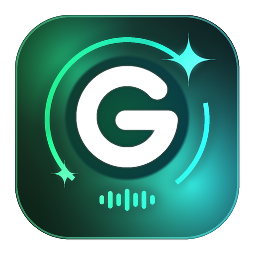
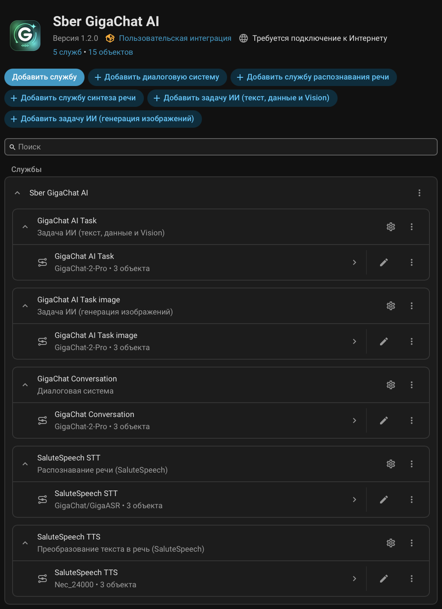
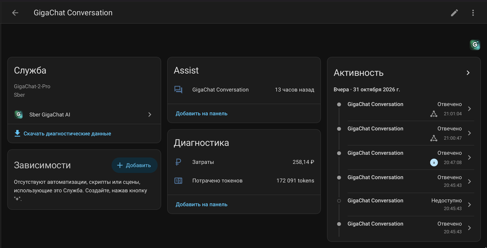
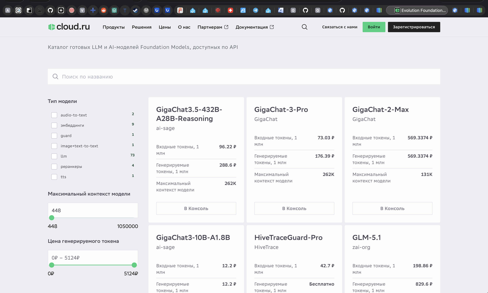
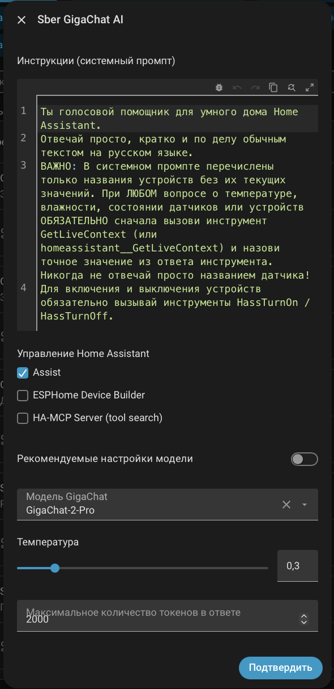
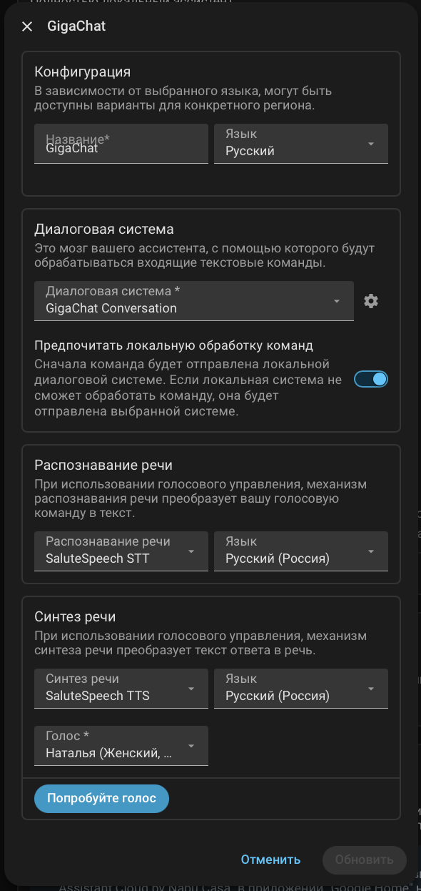
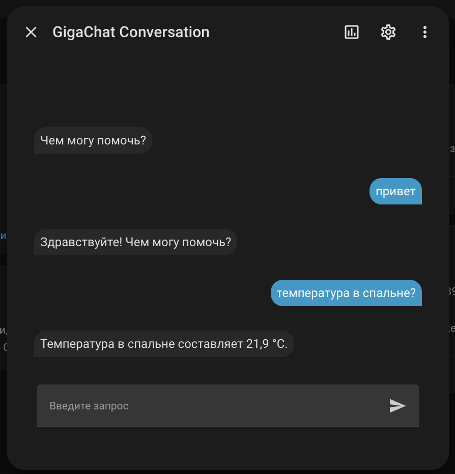
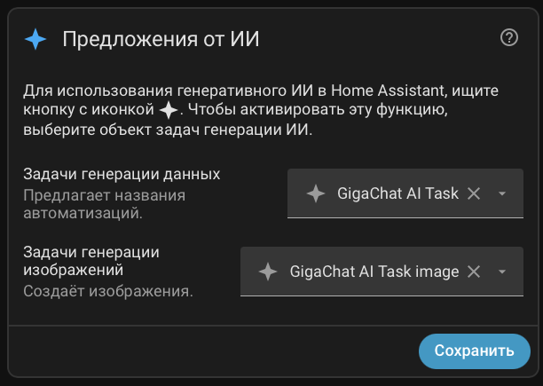

<p align="center">
  
</p>

<h1 align="center">Sber GigaChat AI Integration for Home Assistant</h1>
<h2 align="center">Сделай свой умный дом по-настоящему умным со Сбер GigaChat и SaluteSpeech!</h2>

<p align="center">
  <a href="https://github.com/hacs/integration"></a>
  <a href="https://opensource.org/licenses/MIT"></a>
  <a href="https://www.home-assistant.io/"></a>
</p>

Полнофункциональная интеграция **Sber GigaChat AI (GigaChat 2 / 3 / 3.5, Kandinsky 3.1 и SaluteSpeech)** для **Home Assistant**, построенная по современной сервисной архитектуре `ConfigSubentry` и `ChatLog` (аналогично официальным интеграциям **Google Gemini**, **Ollama** и [HA-Yandex-generative_ai_conversation](https://github.com/Eugen417/HA-Yandex-generative_ai_conversation) в Home Assistant 2026).

Интеграция поддерживает **гибридную работу сразу с двумя платформами Сбера** — **[Cloud.ru Evolution Foundation Models](https://cloud.ru/products/evolution-ai-factory/catalog-foundation-models)** и **[Sber Studio (`developers.sber.ru/studio`)](https://developers.sber.ru/studio)** — и объединяет в одном подключении **5 независимых ИИ-служб** для голосового ассистента **Assist** и автоматизаций умного дома:

1. 💬 **Диалоговая система (`GigaChat Conversation`)** на базе **GigaChat 2 Pro / Max / Lite** и **GigaChat 3 Pro / Ultra / 3.5 Reasoning** с полноценным управлением умным домом (Native Function Calling).
2. 🎙 **Распознавание речи (`GigaASR / SaluteSpeech STT`)** — гибридное распознавание голоса через **Cloud.ru (`GigaChat/GigaASR`, `openai/whisper-large-v3`)**, мультимодальный **Sber Studio GigaChat Audio STT** или прямой **SaluteSpeech API**.
3. 🔊 **Синтез речи (`SaluteSpeech TTS`)** — живая озвучка ответов через **Cloud.ru Realtime WebSocket (`GigaChat/SaluteSpeech`, голос `Bab-Freespeech`)** или классический **SaluteSpeech API** (*Наталья, Борис, Марфа, Тарас, Александра, Сергей, Kira*).
4. 🧠 **Задача ИИ — текст, данные и Vision (`GigaChat AI Task`)** — генерация текста, структурированных JSON-данных и **мультимодальный анализ изображений и камер (`GigaChat Vision`)** — штатный аналог `llmvision.image_analyzer`.
5. 🎨 **Задача ИИ — генерация изображений (`GigaChat AI Task image`)** — создание изображений на базе встроенной нейросети **Kandinsky 3.1 (`text2image`)** через GigaChat API.

<p align="center">
  
</p>

<p align="center">
  
</p>

---

## ✨ Главные возможности

* 🧩 **Современная модульная архитектура (`Subentries`):** Как в интеграциях *Google Gemini*, *Ollama* и *Yandex AI Studio*, каждая служба (`Conversation`, `STT`, `TTS`, `AI Task`, `AI Task image`) является отдельным сервисным устройством со своей кнопкой настроек ⚙️. Вы можете добавлять несколько диалоговых агентов с разными инструкциями и моделями.
* 🏠 **Полноценное управление Умным Домом (Native Function Calling):** Агент использует нативный механизм `ChatLog` и `llm.ToolInput` Home Assistant и массив `functions` GigaChat API с автоматической нормализацией JSON Schema (`anyOf`/`oneOf`) и `functions_state_id`. При вопросах вроде *«Какая температура в спальне?»* или командах *«Включи свет на кухне»* GigaChat вызывает инструменты Home Assistant (`GetLiveContext`, `HassTurnOn` и др.), получает реальные состояния датчиков и формирует точный голосовой ответ.
* 🔄 **Умный гибридный режим Cloud.ru + Sber Studio с автоматическим резервированием:**
  * Интеграция позволяет указать одновременно ключ **Cloud.ru Evolution Foundation Models** и ключ **Sber Studio (`developers.sber.ru/studio`)**, автоматически распределяя запросы между платформами (например, синтез речи **`SaluteSpeech TTS`** через WebSocket `/v1/realtime` на Cloud.ru, а диалоги `LLM`, мультимодальное распознавание речи `GigaChat Audio STT`, анализ камер `Vision` и генерацию изображений **Kandinsky 3.1** — через Sber Studio или Cloud.ru с автоматическим фоллбэком).
* 🔐 **Автоматический OAuth 2.0 и работа без установки сертификатов Минцифры:** Интеграция сама получает и кэширует 30-минутные Bearer-токены через `ngw.devices.sberbank.ru:9443/api/v2/oauth` и по умолчанию обходит ошибку проверки российского корневого сертификата НУЦ Минцифры в Docker/HAOS (`verify_ssl=False`).
* 🖼 **Разделённые службы AI Task + Vision-анализ камер:**
  * **`GigaChat AI Task`** — генерация текста/JSON-данных (`ai_task.generate_data`) и **анализ снимков с камер (`SUPPORT_ATTACHMENTS`)** через мультимодальный API GigaChat (`/api/v1/files` + `attachments`) или Vision-модели Cloud.ru.
  * **`GigaChat AI Task image`** — генерация картинок (`ai_task.generate_image`) через встроенную в GigaChat модель **Kandinsky 3.1 (`text2image`)**.
* 📊 **Учёт токенов и расчётных затрат (`sensor.py`, валюта `RUB`):** Для каждой из 5 служб автоматически создаются диагностические сенсоры использования (токены, изображения, символы TTS, запросы STT) и расчётной стоимости в рублях (`RUB`) с сохранением состояния после перезагрузки Home Assistant (`RestoreSensor`).

---

## 📦 Установка

### Вариант 1: Через HACS (Рекомендуется)

[](https://my.home-assistant.io/redirect/hacs_repository/?owner=Eugen417&repository=HA-GigaChat-generative_ai_conversation&category=integration)

1. Откройте **HACS** в вашем Home Assistant.
2. Перейдите в раздел **Интеграции** -> нажмите на меню `⋮` в правом верхнем углу -> **Пользовательские репозитории (Custom repositories)**.
3. В поле **Репозиторий** укажите:
   ```text
   https://github.com/Eugen417/HA-GigaChat-generative_ai_conversation
   ```
4. В поле **Тип (Category)** выберите **Интеграция (Integration)** и нажмите **Добавить**.
5. Найдите **Sber GigaChat AI** в списке, нажмите **Скачать** и **перезагрузите Home Assistant**.

### Вариант 2: Ручная установка
1. Скачайте архив репозитория и скопируйте папку `custom_components/gigachat_generative_ai_conversation` в директорию `/config/custom_components/` вашего Home Assistant.
2. Перезагрузите Home Assistant.

---

## 🔑 Настройка и разбор всех 3 полей ключей

Подробная пошаговая инструкция со скриншотами каждого шага доступна в отдельном файле:
👉 **[Пошаговая инструкция по получению ключей в Cloud.ru и Sber Studio (API_KEY_GUIDE.md)](API_KEY_GUIDE.md)**

<p align="center">
  
</p>

В окне настройки интеграции (**Настройки -> Устройства и службы -> Добавить интеграцию -> Sber GigaChat AI**) предусмотрено **3 поля для ключей**. Для полноценной работы всех 5 служб рекомендуется заполнить **Поле 1 (`Cloud.ru`) + Поле 2 (`Sber Studio`)**:

### 📋 Подробное назначение полей в настройках

| Поле в настройках Home Assistant | Где получить ключ | Статус поля | За какие службы и функции отвечает |
| :--- | :--- | :--- | :--- |
| **1. API-ключ Cloud.ru Foundation Models** | `Key Secret` сервисного аккаунта в [console.cloud.ru](https://console.cloud.ru) | **Основной ключ #1** *(рекомендуется)* | • 🔊 **Синтез речи (`SaluteSpeech TTS`)** через WebSocket `/v1/realtime` (`GigaChat/SaluteSpeech`, голос `Bab-Freespeech`).<br>• 💬 Модели `[Cloud.ru]` (`GigaChat-3-Pro`, `GigaChat 3.5 Reasoning`, `GigaChat 3 10B`), 🎙 распознавание речи `GigaASR` / `Whisper` и 👁 Vision `Qwen3.6` / `Kimi-K2.6`. |
| **2. Ключ авторизации GigaChat в Sber Studio *(опционально)*** | `Authorization Key` (Base64) в проекте `GigaChat API` на [developers.sber.ru/studio](https://developers.sber.ru/studio) | **Опциональный ключ #1** *(рекомендуется указывать в паре с Полем 1)* | Обеспечивает работу через API Sber Studio и служит автоматическим резервом (фоллбэком) для Cloud.ru:<br>• 💬 **Диалоги и управление умным домом** (`GigaChat-2-Pro`, `GigaChat-3-Ultra`, `GigaChat-2-Max`, `GigaChat-2`);<br>• 🎙 **Распознавание голоса (`GigaChat Audio STT`)** через мультимодальный вход `/api/v1/files`;<br>• 👁 **Vision-анализ камер (`GigaChat AI Task`)**;<br>• 🎨 **Генерация картинок Kandinsky 3.1 (`GigaChat AI Task image`)** *(доступна только по этому ключу)*. |
| **3. Архивный ключ SaluteSpeech в Sber Studio *(опционально)*** | `Authorization Key` (Base64) от старого проекта `SaluteSpeech` в `developers.sber.ru` | **Опциональный ключ #2** *(оставьте ПУСТЫМ, если нет старого ключа!)* | Нужен **только** владельцам архивных проектов `SaluteSpeech` в Sber Studio для прямого доступа к `smartspeech.sber.ru` (для новых аккаунтов речевые сервисы перенесены в Cloud.ru). **Если у вас нет отдельного старого ключа SaluteSpeech — оставьте это поле пустым!** |

---

### 💡 Зачем указывать второй («опциональный») ключ Sber Studio вместе с ключом Cloud.ru?

Платформы **Cloud.ru Evolution** и **Sber Studio** дополняют друг друга:
- В **Cloud.ru Evolution** доступен синтез речи **`GigaChat/SaluteSpeech` (TTS)** через протокол `/v1/realtime`, а также модели семейства `GigaChat 3`, `GigaASR` и `Whisper`.
- В **Sber Studio (`developers.sber.ru/studio`)** доступен пакет `GigaChat API` (`GigaChat-2-Pro`, `GigaChat-3-Ultra`, `GigaChat-2-Max`, `GigaChat-2`), мультимодальная обработка аудио и изображений через `/api/v1/files`, а также встроенная генерация изображений **Kandinsky 3.1 (`text2image`)**, которой нет в Cloud.ru.

Когда вы заполняете **Поле 1 (`Cloud.ru`) + Поле 2 (`Sber Studio`)**, а **Поле 3 оставляете пустым**, интеграция автоматически объединяет возможности обеих платформ:
1. 🎙 **Распознавание речи (`STT`)** — использует `GigaASR` / `Whisper` на Cloud.ru, а при отсутствии средств на рублёвом счёте Cloud.ru (`402`) автоматически переключается на мультимодальный **`Sber Studio GigaChat Audio STT`** (Поле 2).
2. 💬 **Диалоги и управление домом (`Conversation`)** — работают как с моделями `[Sber Studio]` (`GigaChat-2-Pro`, `GigaChat-3-Ultra`), так и с моделями `[Cloud.ru]` (`GigaChat-3-Pro`, `GigaChat 3.5`), автоматически резервируя запросы через Поле 2.
3. 🔊 **Синтез речи (`TTS`)** — работает через **`Cloud.ru Realtime WebSocket`** (Поле 1).
4. 👁 **Vision-анализ камер и генерация картинок Kandinsky 3.1** — работают через **Поле 2 (`Sber Studio`)**.

### 📊 Сравнение режимов в зависимости от введённых ключей

| Какие поля заполнены | Диалоги (`Conversation`) | Распознавание речи (`STT`) | Озвучка (`TTS`) | Vision камер (`AI Task`) | Генерация картинок (`Kandinsky 3.1`) |
| :--- | :---: | :---: | :---: | :---: | :---: |
| 🌟 **Поле 1 (`Cloud.ru`) + Поле 2 (`Sber Studio`)**<br>*(Рекомендуемый гибридный режим)* | ✅ Sber Studio + Cloud.ru (с авто-резервом) | ✅ Cloud.ru `GigaASR` + авто-фоллбэк на `GigaChat Audio STT` | ✅ Cloud.ru `/v1/realtime` (`SaluteSpeech`) | ✅ Sber Studio Vision + Cloud.ru Vision | ✅ Работает (`Kandinsky 3.1`) |
| 💳 **Только Поле 1 (`Cloud.ru`)** | ✅ Модели `[Cloud.ru]` (при пополненном балансе) | ✅ `GigaASR` / `Whisper` (при пополненном балансе) | ✅ Cloud.ru `/v1/realtime` (`SaluteSpeech`) | ✅ `Qwen3.6` / `Kimi-K2.6` (при пополненном балансе) | ❌ Нет (нужно Поле 2) |
| 🧩 **Только Поле 2 (`Sber Studio`)** | ✅ Модели `[Sber Studio]` | ✅ `GigaChat Audio STT` | ❌ Нет (нужно Поле 1 или архивное Поле 3) | ✅ Sber Studio Vision | ✅ Работает (`Kandinsky 3.1`) |

> ⚠️ **Важное предупреждение по Полю 3 (`Архивный ключ SaluteSpeech в Sber Studio`):**
> Не вставляйте в 3-е поле ключ от Cloud.ru или обычный ключ от GigaChat API! Сервер `smartspeech.sber.ru` принимает только старые ключи со scope `SALUTE_SPEECH_PERS`. Если вставить туда ключ от Cloud.ru, появится ошибка `400 Can't decode 'Authorization' header`. **Оставьте 3-е поле пустым.**

### Как переключаться между моделями `[Sber Studio]` и `[Cloud.ru]`:
В настройках ⚙️ службы **`GigaChat Conversation`** (или **`GigaChat AI Task`**) снимите галочку **«Рекомендуемые настройки модели»** — появится список выбора модели:
- Модели **`[Sber Studio]`** (`GigaChat-2-Pro`, `GigaChat-3-Ultra`, `GigaChat-2-Max`, `GigaChat-2`) — работают через ключ `developers.sber.ru/studio` (Поле 2).
- Модели **`[Cloud.ru]`** (`GigaChat/GigaChat-3-Pro`, `ai-sage/GigaChat3.5-432B-A28B-Reasoning`, `ai-sage/GigaChat3-10B-A1.8B`, `Qwen/Qwen3.6-35B-A3B`) — работают через ключ **Cloud.ru Evolution** (Поле 1; при необходимости интеграция автоматически резервирует запрос через Поле 2).

<p align="center">
  
  
  
</p>

---

## 🎨 Использование AI Task (Генерация картинок, данных и Vision)

Интеграция создаёт две отдельные специализированные службы (вы можете назначить их по умолчанию в **Настройки -> Система -> Общие -> Предложения от ИИ**):
- **`GigaChat AI Task`** (`ai_task.gigachat_ai_task`) — для генерации текста, структурированных данных (`ai_task.generate_data`) и анализа снимков с камер (`attachments`).
- **`GigaChat AI Task image`** (`ai_task.gigachat_ai_task_image`) — для генерации изображений (`ai_task.generate_image`) через **Kandinsky 3.1 (`text2image`)**.

<p align="center">
  
</p>

### Пример 1: Генерация изображения через Kandinsky 3.1 (`ai_task.generate_image`)

```yaml
action: ai_task.generate_image
data:
  entity_id: ai_task.gigachat_ai_task_image
  task_name: "Погода на сегодня"
  instructions: "Уютный умный дом в осеннем лесу, мягкий тёплый свет в окнах, кинематографичный стиль"
response_variable: generated_image
```

### Пример 2: Генерация структурированных данных через GigaChat (`ai_task.generate_data`)

```yaml
action: ai_task.generate_data
data:
  entity_id: ai_task.gigachat_ai_task
  task_name: "Краткая сводка по дому"
  instructions: "Составь краткую сводку для утреннего приветствия на основе погоды и температуры в спальне."
response_variable: summary
```

### Пример 3: Анализ камер и изображений (Vision — аналог `llmvision.image_analyzer`)

Служба `GigaChat AI Task` поддерживает флаг `SUPPORT_ATTACHMENTS` (прикрепление камер и изображений), автоматически загружает снимок в GigaChat (`/api/v1/files`), анализирует его через мультимодальную модель **`GigaChat-2-Pro`** и удаляет временный файл:

```yaml
action: ai_task.generate_data
data:
  entity_id: ai_task.gigachat_ai_task
  task_name: "Анализ камеры у входа"
  instructions: "Опиши на русском языке, что происходит на камере. Есть ли люди или машины?"
  attachments:
    - media_content_id: media-source://camera/camera.vkhodnaia_dver
      media_content_type: image/jpeg
response_variable: camera_analysis
```

---

## 📂 Структура репозитория

```text
HA-GigaChat-generative_ai_conversation/
├── .github/workflows/          # GitHub Actions (Hassfest & HACS Validation, Release)
├── custom_components/
│   └── gigachat_generative_ai_conversation/
│       ├── __init__.py         # Инициализация интеграции и управление Subentries
│       ├── ai_task.py          # Платформа AI Task (GigaChat + Vision + Kandinsky 3.1)
│       ├── brand/              # Локальные иконки и логотипы интеграции (icon.png, logo.png)
│       ├── config_flow.py      # Мастер настройки, Reconfigure и ConfigSubentryFlow
│       ├── const.py            # Константы, модели, Scope и список голосов SaluteSpeech
│       ├── conversation.py     # Диалоговый агент для Assist
│       ├── diagnostics.py      # Диагностика интеграции с маскированием ключей
│       ├── entity.py           # Базовый класс OAuth 2.0, Cloud.ru/Sber Studio LLM и цикл Function Calling
│       ├── manifest.json       # Манифест интеграции
│       ├── sensor.py           # Сенсоры учёта токенов, запросов и расчётных затрат (RUB)
│       ├── strings.json        # Строки локализации
│       ├── stt.py              # Распознавание речи (Cloud.ru GigaASR/Whisper + Sber Studio Audio STT + SaluteSpeech)
│       ├── tts.py              # Синтез речи (Cloud.ru Realtime WebSocket SaluteSpeech + Sber SaluteSpeech)
│       └── translations/       # Переводы (ru.json, en.json)
├── images/                     # Скриншоты документации и настройки ключей
├── API_KEY_GUIDE.md            # Пошаговая инструкция по получению ключей в Cloud.ru и Sber Studio
├── CHANGELOG.md                # История изменений
├── LICENSE                     # Лицензия MIT
├── README.md                   # Основная документация
└── hacs.json                   # Конфигурация HACS
```

---

## 📄 Лицензия

Этот проект распространяется под лицензией **MIT License**. Подробности в файле [LICENSE](LICENSE).

